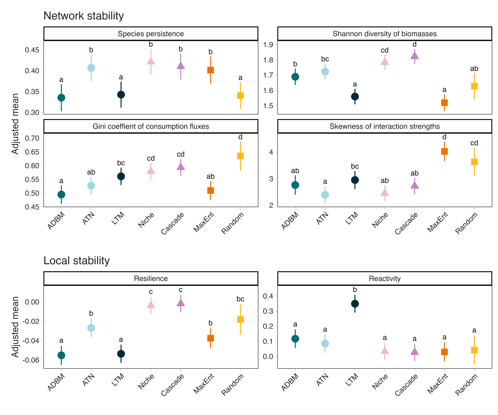
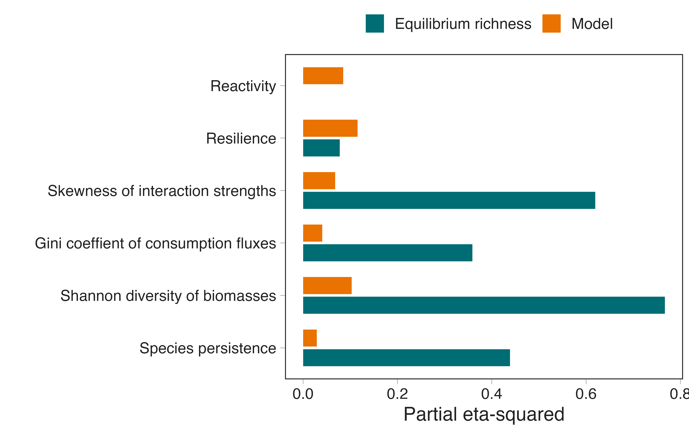

# Network Topology

**Table S1: Network structural measures used for multivariate analyses**

| Label | Definition | Structural interpretation | Reference |
|------------------|------------------|-------------------|------------------|
| Basal | Proportion of taxa with zero vulnerability (no consumers). | Quantifies the proportion of species representing basal energy inputs to the network. |  |
| Top | Proportion of taxa with zero generality (no resources). | Describes the relative prevalence of terminal consumers in the network. |  |
| Intermediate | Proportion of taxa with both consumers and resources. | Captures the proportion of species participating in both upward and downward energy transfer. |  |
| Richness (S) | Number of taxa (nodes) in the network. | Describes network size. |  |
| Links (L) | Total number of trophic interactions (edges). | Describes interaction density independent of network size. |  |
| Connectance | $L/S^2$, where $S$ is the number of species and $L$ the number of links | Measures the proportion of realised interactions relative to all possible interactions. |  |
| L/S | Mean number of links per species. | Captures average interaction density per taxon. |  |
| Cannibal | Proportion of taxa with self-loops. | Quantifies the prevalence of cannibalistic interactions. |  |
| Herbivore | Proportion of taxa feeding exclusively on basal species. | Describes the representation of primary consumers. |  |
| Trophic level (TL) | Prey-weighted trophic level averaged across taxa. | Captures the vertical organisation of energy transfer. |  @williams2004 |
| MaxSim | Mean maximum trophic similarity of each taxon to all others. | Quantifies functional similarity based on shared predators and prey. | @yodzis1999 |
| Centrality | Sum of differences between the maximum node centrality and all node centralities (Freeman's centrality). | Captures how unevenly influence or connectivity is distributed among species. | @estrada2008 |
| ChLen | Mean length of all food chains from basal to top taxa. | Describes the average number of steps in energy-transfer pathways. |  |
| ChSD | Standard deviation of food chain length. | Captures variability in pathway lengths. |  |
| ChNum | Log-transformed number of distinct food chains. | Quantifies the multiplicity of alternative energy pathways. |  |
| Path | Mean shortest path length between all species pairs. | Describes the average distance between taxa within the network. |  |
| Diameter | Maximum shortest path length between any two taxa. | Captures the largest network distance between species. |  |
| Omnivory | Proportion of taxa feeding on resources at multiple trophic levels. | Describes vertical coupling of energy channels. | @mccann2000 |
| Loop | Proportion of taxa involved in trophic loops. | Quantifies the prevalence of cyclic interaction pathways. |  |
| Prey:Predator | Ratio of prey taxa (basal + intermediate) to predator taxa (intermediate + top). | Describes the overall shape of the trophic structure. |  |
| Clust | Mean clustering coefficient. | Measures the tendency for taxa sharing interaction partners to also interact with each other. | @watts1998 |
| GenSD | Normalised standard deviation of generality. | Captures heterogeneity in the number of resources per taxon. | @williams2004 |
| VulSD | Normalised standard deviation of vulnerability. | Captures heterogeneity in the number of consumers per taxon. | @williams2004 |
| LinkSD | Normalised standard deviation of total links per taxon. | Quantifies variation in species connectivity. |  |
| Intervality | Degree to which taxa can be ordered along a single niche dimension. | Measures the extent of niche ordering in trophic interactions. | @stouffer2006 |
| S1 (Linear chain) | Frequency of three-node linear chains (A → B → C) with no additional links. | Captures the prevalence of simple, unbranched energy-transfer pathways. | @stouffer2007 @milo2002 |
| S2 (Omnivory) | Frequency of three-node motifs forming a feed-forward loop (A → B → C, A → C). | Describes vertical coupling of trophic levels within small subnetworks. | @stouffer2007 @milo2002 |
| S4 (Direct competition) | Frequency of motifs where two consumers share a single resource (A ← B → C). | Describes the occurrence of shared-resource structures among consumers. | @stouffer2007 @milo2002 |
| S5 (Apparent competition) | Frequency of motifs where one consumer feeds on two resources (A → B ← C). | Captures the prevalence of shared-predator structures among resources. | @stouffer2007 @milo2002 |
| trophicVar | Measure of how much the trophic positions of species deviate from the mean trophic level. | Variance is linked to chain length, with low variance indicating few long chains and high variance indicates long chains and varied interactions | @pimm1982 |
| TrophicCoherence | Measure how well the species in a food web fit into discrete trophic levels. | Highly coherent, neatly layered food webs are more stable to perturbations | @johnson2014 |

# Results and Discussion

## Structural convergence does not imply dynamical equivalence

**Figure S1: Network stability is driven by network structure, especially at the local scale**

After accounting for equilibrium richness, Niche, Cascade, ATN and MaxEnt generally supported higher species persistence than ADBM, LTM and Random generated food webs. Biomass diversity was highest in Cascade and Niche webs, but comparatively low in LTM and MaxEnt. Random model had the most uneven consumption fluxes, while MaxEnt and Random webs showed the strongest skewness in interaction strengths. ADBM and LTM generated food webs showed the highest resilience, i.e.,fastest asymptotic recovery, whereas LTM food webs were also the most reactive, i.e., strongest initial amplification of perturbations.

{#fig-emmeans}

**Figure S2: Equilibrium richness explains more variation at network-level stability metrics**

We used Type II ANOVA to assess the contribution of each predictor while controlling for the other. The magnitude of each association was quantified using partial eta-squared, which represents the proportion of effect-plus-residual variation attributable to a predictor after accounting for the other predictor.

Equilibrium richness explained substantially more variation than generative food web models in network-level stability metrics, with the strongest contribution observed for Shannon diversity of biomasses, followed by the skewness of interaction strengths, species persistence and the Gini coefficient of consumption fluxes. In contrast, variation in resilience was influenced by both richness and model, with a larger contribution from model. Reactivity was explained primarily by generative food web models, with very little contribution from equilibrium richness.

{#fig-rel_contribution}

# References {.unnumbered}